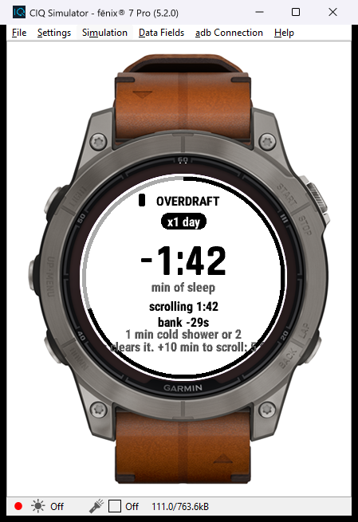
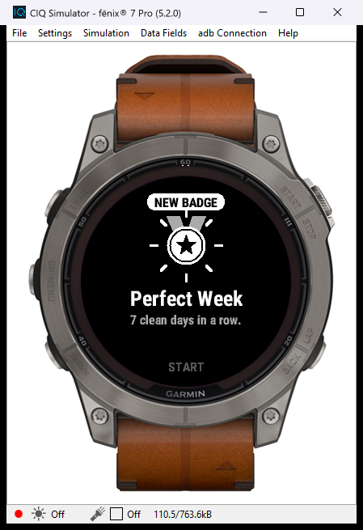
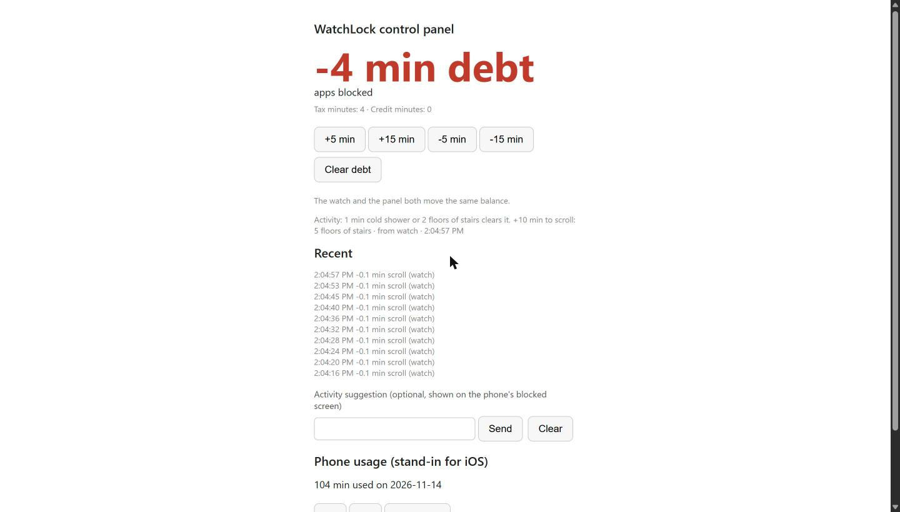

# Thumb Tax

A screen-time bank on your wrist. Phone minutes are charged to a balance, the watch verifies exercise, chores and calm time with its sensors, and verified time pays the balance back. An iPhone app blocks your chosen apps while you owe time.

Built for the Tech Thursday x Garmin hackathon (Calgary, 2026-11-14). Prompt: "build something that makes your own health and wellness better."

## The problem

Doomscrolling costs sleep and focus, and it costs the most late at night, when one more swipe feels free. Nothing tells you the price while you are paying it. Thumb Tax shows the price on your wrist, live, and gives you a way to earn the time back.

## Screenshots



The watch's live scroll meter in the Connect IQ simulator (fenix 7 Pro): OVERDRAFT, x1 day rate, -1:42 min of sleep while scrolling, bank at -29 s, and the payoff suggestion.



A badge unlocked from the control panel: the watch shows its new-badge screen for Perfect Week within a few seconds.



The server's control panel: -4 min of debt with apps blocked, the +/-5 and 15 minute buttons, Clear debt, the watch's suggestion and the recent transactions from the watch. It can also unlock any badge on the watch for demos, from a badge list with "Unlock on watch".

iPhone screenshots (`docs/screenshots/iphone-blocked.png`) are to be added by the iOS developer.

## Architecture

Three parts share one bank. The server holds the balance. The watch and the panel change it with transactions. The iPhone reads it.

```
  iPhone (WatchLock)         Watch (Connect IQ)         Control panel
  GET /state                 POST /ledger               POST /ledger
  POST /usage                GET /state                 POST /usage
       |                          |                          |
       +---- HTTPS (Cloudflare tunnel, x-api-key header) ----+
                                  |
                   Server (laptop, Node, no dependencies)
                   THE BANK: balanceSec, history, phone usage
```

| Part | What it does |
|---|---|
| Server (`server/server.js`) | Holds `balanceSec`. `taxMinutes` and `creditMinutes` are derived: the balance minus phone minutes not yet charged. Takes numbered transactions on `POST /ledger` (watch, panel), the iPhone's running total on `POST /usage`, and serves `GET /state`. Plain Node, no dependencies, behind a public HTTPS Cloudflare tunnel. Calls need the `x-api-key` header. Contract in `server/README.md` |
| Watch app (`source/`, fenix 7 Pro) | Turns new phone minutes into charges: day x1, night x2, in bed x3. Verifies activities with sensors. Sends each charge or credit as a numbered transaction that the server applies once. Mirrors the server balance. Ranks payoff suggestions by time. Awards badges and draws trends. One Timer in `Engine.mc` drives the whole backend |
| iPhone app (`ios/`, WatchLock, SwiftUI + Screen Time) | Reads `GET /state` every 3 s. Blocks the chosen apps while `taxMinutes` is above 0 and shows the watch's suggestion. Shows a green screen with the earned time when clear. "Scroll anyway" adds 5 minutes of use through `POST /usage` |
| Control panel (served by the server at `/`) | Adds or removes minutes on the same balance, a phone-usage stand-in for demos, a list of recent transactions, and a badge list with "Unlock on watch" that unlocks any badge on the watch for demos, sent through `POST /badge` |

### Watch backend

| File | Purpose |
|---|---|
| `Engine.mc` | The 1 Hz heartbeat and the only Timer. Reads sensors, charges, buzzes in overdraft, saves, drives Sync and Activities |
| `Sync.mc` | Polls the server, turns new phone minutes into scroll seconds, keeps the outbox of numbered transactions (session plus event id), mirrors the server balance, builds the payoff suggestion |
| `Ledger.mc` | The signed balance, multipliers, overdraft, daily stats, history |
| `Catalog.mc` | The single list of 29 activity kinds, detectors, thresholds and rates |
| `Activities.mc` | Table-driven detectors that verify and credit activities |
| `Badges.mc` | Clean days, streaks, windows, monthly savings, badge awards |
| `Records.mc` | Stored history behind the trend pages |
| `*Test.mc` | Unit tests for activities, badges, ledger, records and sync |

`source/screens/` holds the watch UI: hub menu, activity picker and session, scroll meter, scroll feed, badge views, alerts. `source/` holds the mascot, the trend pages and their chart primitives.

### Data flow

```
phone minutes (server) --> Sync --> Engine (1 Hz) --> Ledger --> UI
                                        |                ^
                                        +--> Records ----+
                                        +--> Badges -----+
Activities (sensors) --> Ledger, Badges
Ledger changes --> Sync outbox --> POST /ledger --> server balance --> Sync mirror
```

Sync polls the server every 4 s and converts new iPhone minutes into scroll seconds. Minutes counted but not yet charged are reported as `pendingChargeSec`, so the iPhone sees debt before the watch has finished charging. A charge or credit goes out as one transaction with a session and an event id. If a reply is lost the watch resends the same id and the server applies it once. After each reply the watch takes the server balance and adds back anything the server has not seen. State saves to on-watch storage every 30 s while charging and when a session ends.

## How it works: the bank

There is one balance, measured in time. It can go negative.

| Event | Effect on balance |
|---|---|
| Phone use in the day (06:00 to 22:00) | Charged 1x |
| Phone use at night (22:00 to 06:00) | Charged 2x (the sleep fee) |
| Phone use at night in bed (wrist temperature at or above 33.0 C, estimated) | Charged 3x |
| Phone use while the balance is negative (overdraft) | The watch buzzes, at most once every 10 s |
| Verified exercise, chores, outdoor time or calm time | Credited as a "tax return" (see the activity tables) |

Paying off debt and earning credit use the same path. A negative balance is debt that exercises pay down. A positive balance is credit to scroll later. Walking is credited per kilometre and per metre climbed, and stairs per floor.

The last 20 balance changes are kept as a history. Daily totals (day scroll, night scroll, sleep fee, earned back) reset at local midnight.

### Payoff suggestions

When you owe time, the watch ranks activities by how long each takes to clear the debt, using typical paces (estimated, not measured). Example: "14 min high knees or 14 min plank clears it. +10 min to scroll: 5 floors of stairs."

## How phone use is detected

The iPhone app reports usage. Its running total of minutes goes to `POST /usage`, the server keeps it per day, and the watch converts new minutes into charges. When the server cannot be reached the watch shows a sync status such as SYNC OFFLINE, SYNC 401 KEY or SYNC -1001 HTTPS, and nothing is charged for the gap.

The on-wrist path is the idea for real hardware: the magnetometer field compared with a baseline (a jump of more than 40 units suggests a phone near the wrist) plus the accelerometer wrist pose of holding a phone. It needs a real watch and is not the path used in the simulator demo. The hub's Demo item can force scrolling on or off.

## Earning time back

Each activity starts a detector, runs until you stop it, and credits only what the sensors verified. "Partly verified" means the watch confirms movement and effort but cannot prove the exact exercise, so the credit is an estimate. Where a sensor is missing, the session is flagged estimated, and rep exercises fall back to tapping to count.

Rates are minutes of credit per minute of verified activity, or seconds of credit per rep.

### Exercises

| Activity | Verified by | Pays | Verified |
|---|---|---|---|
| Jumping jacks | Accelerometer peaks (rep counter) | 3 s per rep | Yes |
| Squats | Accelerometer peaks | 6 s per rep | Yes |
| Lunges | Accelerometer peaks | 8 s per rep | Yes |
| High knees | Step cadence of 140 per min or more, heart rate 20 bpm above resting | 3 min per min | Yes |
| March in place | Step cadence of 80 per min or more | 1.5 min per min | Yes |
| Plank | Still wrist (low accelerometer variance) in a face-down pose | 3 min per min | Yes |
| Forearm plank | Same as plank | 3 min per min | Yes |
| Deadbug | Accelerometer peaks, 2 reps per detected cycle | 8 s per rep | Yes |
| Bird-dogs | Accelerometer peaks, 2 reps per detected cycle | 8 s per rep | Partly |
| Push-ups | Forearm tilt away from baseline by 20 degrees and back | 10 s per rep | Partly |
| Chair dips | Forearm tilt by 15 degrees and back | 10 s per rep | Partly |
| Mountain climbers | Heart rate 30 bpm above resting plus vigorous motion | 3 min per min | Partly |
| Glute bridges | Still wrist in a face-up pose | 2 min per min | Partly |

### Chores and outdoor

| Activity | Verified by | Pays | Verified |
|---|---|---|---|
| Cold shower | Skin temperature drop of 3 C, or a heart rate spike of 10 bpm when temperature is missing | 4 min per min, capped at 12 min per session | Yes |
| Stairs | Floor counter | 2 min per floor | Yes |
| Walk or hike | GPS distance plus barometric climb | 10 min per km, plus 12 s per metre climbed | Yes |
| Shovel snow or mow | GPS fix plus heart rate 15 bpm above resting | 1.5 min per min | Yes |
| Dance party | Heart rate 30 bpm above resting plus vigorous motion | 1.5 min per min | Yes |
| Morning sunlight | GPS fix outdoors, started within 2 h of your wake time | 1 min per min, capped at 10 min, once per day | Yes |
| Vacuum, mop or sweep | Heart rate 15 bpm above resting plus steady motion, session of 5 min or more | 1 min per min | Partly |
| Clean windows | Heart rate 15 bpm above resting plus steady motion | 1 min per min | Partly |
| Stretching | Heart rate 5 bpm above resting plus light motion | 0.75 min per min | Partly |

### Calm

Calm sessions count only while the wrist is still and heart rate stays under 90 bpm. Meditation adds a 5 min bonus when average heart rate over the last 30 s is at least 5 bpm below the first 30 s.

| Activity | Verified by | Pays | Verified |
|---|---|---|---|
| Meditation or breathing | Still wrist, heart rate under 90, heart rate drop bonus | 0.5 min per min, plus bonus | Yes |
| Read a book | Still wrist, heart rate under 90 | 0.5 min per min | Yes |
| Origami | Still wrist, heart rate under 90 | 0.5 min per min | Partly |
| Coloring or doodling | Still wrist, heart rate under 90 | 0.5 min per min | Partly |
| Embroidery or cross-stitch | Still wrist, heart rate under 90 | 0.5 min per min | Partly |
| Crochet or punch needle | Still wrist, heart rate under 90 | 0.5 min per min | Partly |
| Puzzle or diamond painting | Still wrist, heart rate under 90 | 0.5 min per min | Partly |

## Sensors

| Sensor | What it does |
|---|---|
| Heart rate | Effort checks against your resting rate, calm checks, the meditation bonus, cardio while scrolling, session average |
| Accelerometer | Rep counting, forearm tilt, still-hold checks, pose, motion variance, wrist pose for phone holding |
| GPS | Walk distance, and the outdoors check for mowing, shoveling and sunlight |
| Barometer / altitude | Climb during walks and hikes |
| Compass / magnetometer | Field disturbance from a phone near the wrist |
| Temperature | In-bed estimate (33.0 C or warmer), cold shower drop |
| Pulse ox | Overnight SpO2 trend page |
| Step and floor counters | Cadence for high knees and march, floors for stairs |
| User profile | Resting heart rate (60 if unset), wake time for sunlight and badge windows, sleep time for the sunset badge (07:00 and 23:00 if unset) |

## Badges

A clean day is a day with no overdraft scrolling and at least 1 h of monitored watch time. "Monitored" means the phone feed was online.

| Badge | Rule |
|---|---|
| First Clean Close | Your first clean day |
| Perfect Week | 7 clean days in a row (repeats) |
| Longest Streak | Beat your best clean streak (best must be at least 3) |
| 100 Clean Days | 100 clean days in total |
| 365 Clean Days | 365 clean days in total |
| 500 Clean Days | 500 clean days in total |
| 1,000 Clean Days | 1,000 clean days in total |
| Screen-Free Morning | No scrolling in the hour after waking, with 45 min monitored |
| Digital Sunset | No scrolling in the hour before bed, with 45 min monitored |
| Perfect Analog Week | 7 days in a row that are both clean and sunset-clean |
| Deep Work 100 | 100 awake minutes in a row without scrolling |
| Analog Fondo | 24 hours without scrolling (gaps up to 10 min are forgiven) |
| Weekend Off-Grid | A Saturday and Sunday each at 30 min of scrolling or less |
| Time Reclaimed: 10 h | Last month's scroll rate saved 10 h against the prior months |
| Time Reclaimed: 25 h | Same, 25 h |
| Time Reclaimed: 50 h | Same, 50 h |
| Local Legend | More credited activity sessions than scroll sessions in 30 days, at least 10 activities |
| Dopamine Detour | A scroll of 10 s or less, then you start an activity within 60 s |
| The Festive Unplug | Dec 24 to Jan 1, each day at 30 min or less |
| Sunday Reset | 4 phone-free Sunday mornings in a month (75% of wake to noon monitored and clean) |

Earning a badge buzzes the watch with a triple pulse. The badges above are the ones the watch can verify from its own clock and sensors.


## The watch UI

The app opens on the thumb mascot, drawn from shapes so it fits the screen. Its mood follows the balance:

| Mood | Screen title | When |
|---|---|---|
| Reward | TAX RETURN | Balance is positive and you earned time in the last 10 min |
| Clear | ALL CLEAR | Nothing owed, not scrolling |
| Taxed | DAY TAX | Scrolling now, or the balance is negative in the day |
| Sleep debt | SLEEP TAX | Balance is negative at night |

The amount shows under the mascot, for example "+12 min" or "-4 min owed". START or MENU opens the hub:

| Hub item | Content |
|---|---|
| Earn time | The activity picker and live sessions |
| Scroll meter | The live meter. In overdraft the whole screen inverts. Shows the rate, sleep lost while scrolling, the bank and the payoff suggestion |
| Badges | Badge list and streak |
| Trends | Week and today pages: scroll tax, sleep debt, cardio while scrolling, tax returns, pulse ox. START toggles WEEK and TODAY |
| Demo | Force scrolling on or off |

Trends count night as 20:00 to 08:00 for exposure, and taxed figures are the seconds the bank actually charged. All shown values are estimates.

## Build and run

Requirements: Connect IQ SDK 9.1.0, Java 17 or newer, your own developer key, Node 18 or newer for the server, and Xcode on a Mac for the iPhone app.

### Demo setup (three machines)

1. Server laptop. Start the server with the key set, then open the tunnel and share the printed https URL.

   ```
   API_KEY=<api-key> node server/server.js
   cloudflared tunnel --url http://localhost:48217
   ```

   In PowerShell set the key first with `$env:API_KEY="<api-key>"`. The control panel is at `http://localhost:48217/`. The tunnel URL changes every time the tunnel restarts.
2. Presentation laptop. Put `<tunnel-url>` and `<api-key>` in `SERVER_BASE` and `API_KEY` in `source/backend/Sync.mc`, then build and run in the simulator.

   ```
   monkeyc -d fenix7pro -f monkey.jungle -o bin/ThumbTax.prg -y <developer_key> -w
   connectiq
   monkeydo bin/ThumbTax.prg fenix7pro
   ```

   Run `connectiq` in one terminal to open the simulator, then `monkeydo` in another. Target: fenix 7 Pro, API 5.2.
3. Mac and iPhone. Copy `ios/WatchLock/Config.swift.example` to `Config.swift` and set `mode = .live`, `serverURL = "<tunnel-url>"` and `apiKey = "<api-key>"`. The modes `.locked` and `.unlocked` use dummy data and need no server. Build with Xcode (`ios/project.yml` describes the project) and run on the iPhone. Pick the apps to block with Screen Time and add a Home Screen shortcut that opens `thumbtax://open?app=Instagram`.

### Tests

```
monkeyc -d fenix7pro -f monkey.jungle -o bin/ThumbTax.prg -y <developer_key> -w --unit-test
monkeydo bin/ThumbTax.prg fenix7pro /t     (Windows)
monkeydo bin/ThumbTax.prg fenix7pro -t     (macOS and Linux)
node server/test.js
```

On Windows use `/t` and relative paths for the watch tests.

Sideloading: connect the watch over USB and copy `bin/ThumbTax.prg` to `GARMIN/APPS`. Magnetometer and wrist behavior are only meaningful on real hardware.

## Privacy

The watch sends balance changes and a short activity name to your own server, and the iPhone sends its usage minutes there. The server runs on your laptop and requires an API key. Nothing goes to a third-party service except the Cloudflare tunnel that carries the traffic. All figures are estimates from wrist sensors. Thumb Tax is not a medical device and gives no diagnosis or medical advice.
